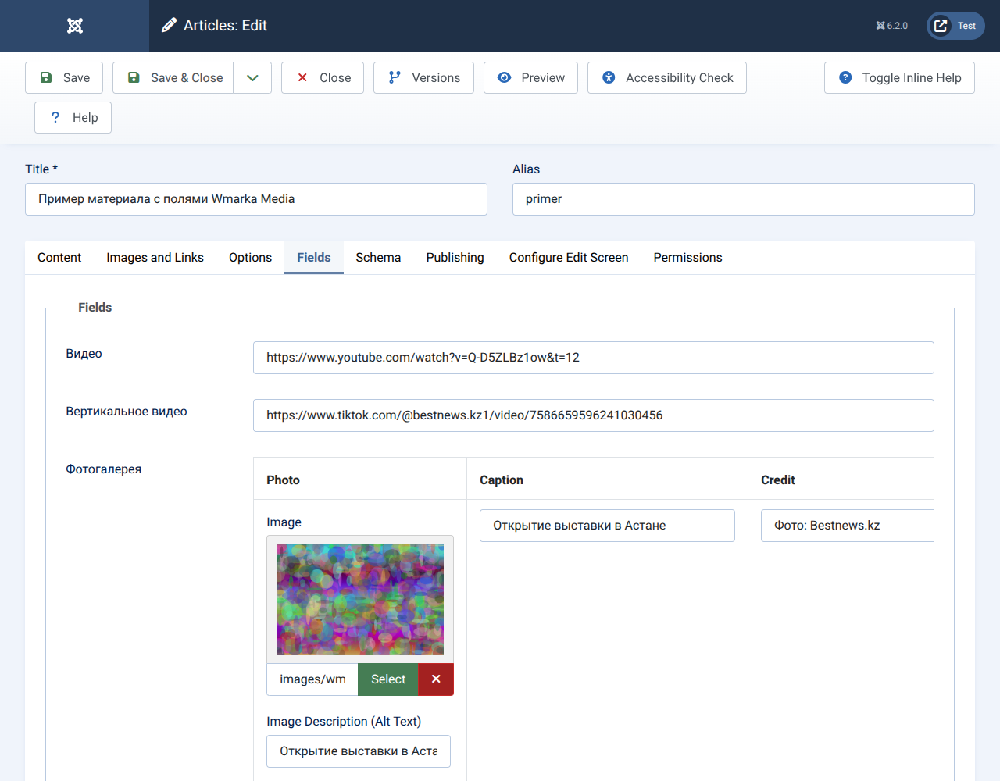
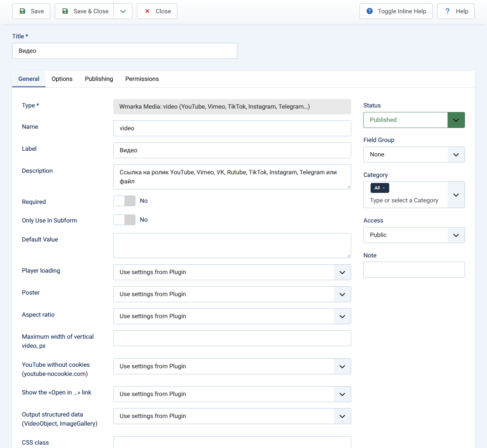
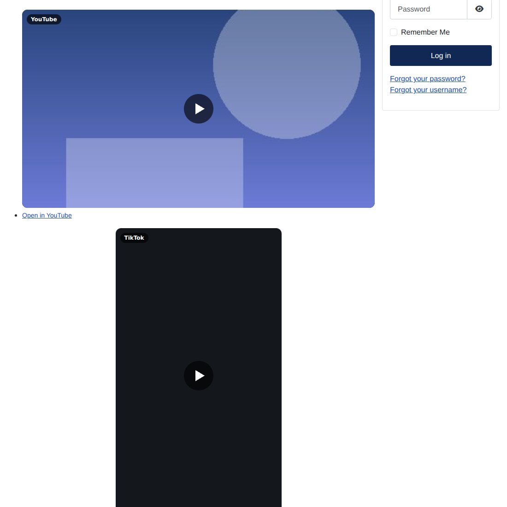
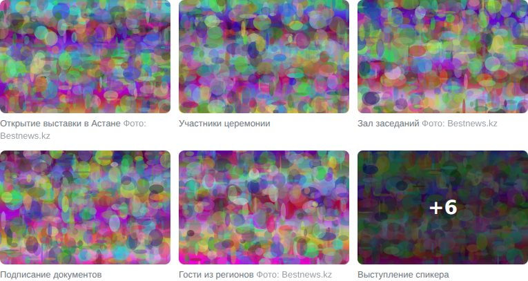
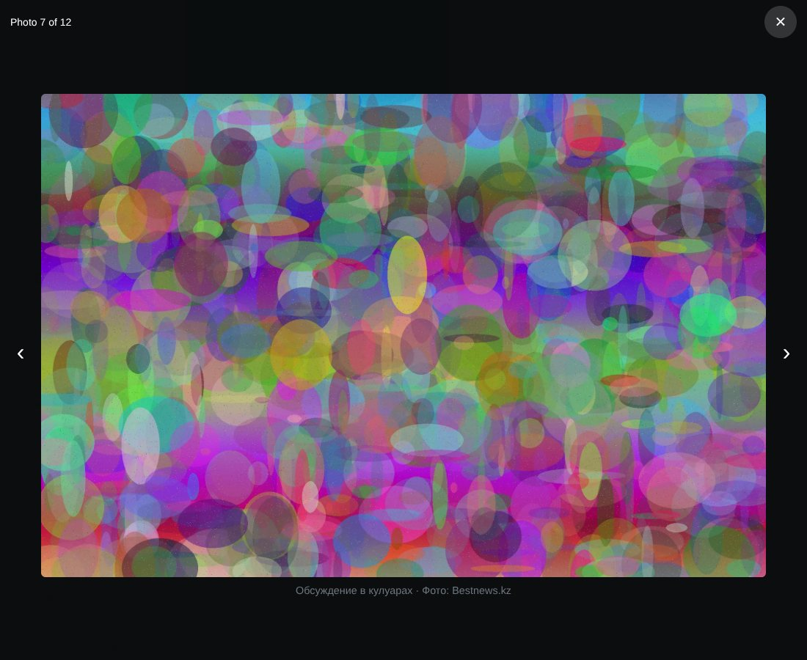

# Wmarka Media — Joomla мақалаларына арналған видео, фотогалерея және сілтемелер тізімі өрістері

[Русский](README.md) · [English](README.en.md) · **Қазақша**

`plg_fields_wmarkamedia` плагині 1.1.3 · Joomla 5.2 және одан жаңа нұсқалары, 6.x қоса · GNU GPL 2-нұсқасы немесе одан жаңасы

## 1. Бұл не

Бір плагин мақалаларға арналған өрістің үш түрін береді:

| Өріс түрі | Редактор не енгізеді | Оқырман не көреді |
|---|---|---|
| **Wmarka Media: видео** | видеоға сілтеме, ендіру коды немесе YouTube-тің «жалаң» идентификаторы | түймесі бар постер; плеер тек басқанда жасалады. YouTube, Vimeo, VK, Rutube, Facebook, Instagram, TikTok, Telegram және .mp4/.webm файлдары |
| **Wmarka Media: фотогалерея** | «фото, жазу, кадр көзі» жолдары | жазулары бар тор және көру терезесі (көрсеткілер, Esc, «Фото 2 / 8») |
| **Wmarka Media: сілтемелер тізімі** | әр жолға бір сілтеме, «\|» таңбасынан кейін тақырып жазуға болады | қызмет атауы бар тізім немесе түймелер |

**Неге бір өріс емес, бір плагин.** Joomla-да өріс плагинінің `tmpl/` қалтасындағы әрбір файл — бөлек өріс түрі (штаттық «Media» плагині төрт түр береді). Видеоның мәні — бір жол, галереяның мәні — жолдар тізімі, сондықтан оларды бір түрге біріктіру мүмкін емес, бірақ бір плагинге біріктіруге болады: бір орнату, видео сілтемелерін талдайтын бір код, бір стиль жиыны және бір скрипт.

## 2. Талаптар және не тексерілді

- Joomla 5.2 немесе одан жаңа; PHP 8.1 немесе одан жаңа (Joomla 6.2 өзі PHP 8.3 талап етеді).
- Таза **Joomla 6.2.0** және **Joomla 5.4.9** орнатуларында тексерілді; PHP 8.3.6, MariaDB 10.11.14, терезесіз Chromium. Толық хаттама — `docs/TESTS.md`.
- Тексерілмегені: Joomla 5.2–5.3 және 6.0–6.1, PHP 8.1/8.2/8.4, PostgreSQL, Apache және Nginx, бөгде қызметтердің нақты ендірмелері (TikTok, Instagram, Telegram, Facebook, VK, Rutube, Vimeo).

## 3. Орнату, жаңарту, жою

- **Орнату.** *Extensions → Install* бөлімінде Releases бетіндегі `plg_fields_wmarkamedia-<нұсқа>.zip` файлын жүктеңіз; немесе `php cli/joomla.php extension:install --path=plg_fields_wmarkamedia-<нұсқа>.zip`. Плагин өздігінен қосылады.
- **Жаңарту.** Joomla жаңа нұсқалар туралы әкімшілік панелінде хабарлайды (*System → Update → Extensions*): плагин жаңартулар серверін тіркейді (осы репозиторийдегі `updates.xml`). Жаңа zip-ті ескісінің үстіне орнатуға да болады; баптаулар мен қосулы күйі сақталады.
- **Жою.** *Extensions → Manage* арқылы немесе `php cli/joomla.php extension:remove <нөмір>`. Файлдар, `media/` ресурстары және тіл файлдары алынады. Жоюдан бұрын осы плагиннің өрістерінің түрін ауыстырыңыз немесе өрістерді жойыңыз: әйтпесе базада белгісіз түрдегі өрістер қалады.
- Интерфейс тілдері: ағылшын, орыс, қазақ.

## 4. Өрісті қалай жасау

*Content → Fields → New* бөлімінде **Type** тізімінен «Wmarka Media: …» түрін таңдаңыз.

- **Видео.** Атауы — кез келген; автоматты шығару ретінде «After Title» немесе «Before Display Content» жақсы келеді; өріс атауын жасырыңыз.
- **Фотогалерея.** Мақала редакторында «Photo, Caption, Credit» бағандары бар кесте және жолдарды қосу, жою, жылжыту түймелері шығады. Фото — «Media» ішінен штаттық таңдау, `alt` мәтінімен бірге.
- **Сілтемелер тізімі.** Мәтін аймағы. Жолдар: `https://t.me/example_channel`, `https://t.me/example_channel | Telegram-да талқылау`, не сілтеменің тікелей артына жабыстырылған тақырып: `https://example.org/page Тақырып`.





## 5. «Видео» қандай сілтемелерді түсінеді

| Қызмет | Қабылданатыны | Тік | Постер |
|---|---|---|---|
| YouTube | `watch?v=`, `youtu.be/`, `/shorts/`, `/live/`, `/embed/`, «жалаң» идентификатор (`?si=…` қосып та), бастау уақыты `t=1m30s` немесе `start=90` | `/shorts/` | иә (`i.ytimg.com`); әдепкіде `youtube-nocookie.com` |
| Vimeo | `vimeo.com/123456789`, арналар мен топтар сілтемелері, `?h=…` бар жабық видеолар | жоқ | жоқ |
| Rutube | `rutube.ru/video/…`, `/play/embed/…`, `/shorts/…` | `/shorts/` | жоқ |
| VK | `vk.com/video-123_456`, `vkvideo.ru/…`, `/clip-…`, `video_ext.php` | `/clip` | жоқ |
| Facebook | `/videos/…`, `/reel/…`, `/watch`, `fb.watch/…`, `/share/v/…`, `/share/r/…` | `/reel/`, `/share/r/` | жоқ |
| Instagram | `/reel/…`, `/reels/…`, `/p/…`, `/tv/…` | `/reel/`, `/tv/` | жоқ |
| TikTok | `tiktok.com/@есім/video/123…`, `embed/v2/…`; **қысқа сілтемелерді** (`vm.tiktok.com/…`) қызметке сұраусыз видео нөміріне айналдыру мүмкін емес, олар сілтеме болып қалады | иә | жоқ |
| Telegram | `t.me/арна/123` (ашық арналар) | жоқ (қатынасы 4:5) | жоқ |
| Файл | `.mp4`, `.webm`, `.ogv`, `.mov`, `.m4v` — абсолютті немесе салыстырмалы мекенжай | жоқ | жоқ |
| Ендіру коды | `<iframe …>` немесе TikTok-тың `<blockquote …>`: тек мекенжай алынады, қалғаны тасталады | мекенжайға қарай | мекенжайға қарай |
| Басқасы | кез келген `http(s)://…` сілтеме | жоқ | жоқ |

Ендірудің әрбір мекенжайы тексерілген бөліктерден (идентификаторлардан) құрастырылады, редактордың мәтінінен емес, сондықтан `src` атрибутына еркін жол түсе алмайды.

## 6. Баптаулар

Жалпы мәндер плагинде беріледі (*Extensions → Plugins → Fields - Wmarka Media*), жеке мәндер — әр өрістің **General** қойындысында. Бос мән «плагиндегідей» дегенді білдіреді.

**Видео:** плеерді жүктеу (басқанда · бірден), постер (қызмет нобайы · суретсіз), қабырғалар қатынасы (авто · 16:9 · 9:16 · 4:5 · 1:1 · 4:3), тік видеоның ең үлкен ені (200–720 px, әдепкі 360), cookie-сіз YouTube (иә), «… ішінде ашу» сілтемесі (иә), микробелгілеу (иә), CSS класы.

**Фотогалерея**

| Баптау | Мәндері | Әдепкі |
|---|---|---|
| Бағандар | 1–6 (телефонда екіден артық емес) | 3 |
| Көру терезесі | иә · жоқ | иә |
| Жазулар, кадр көзі | иә · жоқ | иә |
| Суреттер өлшемі | кішірейтілген көшірмелер (өздігінен жасалады) · түпнұсқалар | көшірмелер |
| Тордағы сурет ені, px | 200–2000 | 640 |
| Көру терезесіндегі сурет ені, px | 800–4000 | 1920 |
| Алғашқы N суретті көрсету | 0 — барлығы; қалғаны көру терезесінде ашылады, соңғы тақтайшада «+K» тұрады | 0 |
| Суреттердің ең көп саны | 0 — шектеусіз | 0 |
| Микробелгілеу, CSS класы | иә · жоқ, мәтін | иә, бос |

**Сілтемелер тізімі:** блок тақырыбы, түрі (тізім · түймелер), жаңа қойындыда ашу (иә), CSS класы.

**Кішірейтілген көшірмелер.** Көшірмелерді Joomla өзі жасайды (GD кітапханасы, `Image` класы), WebP пішімінде, GD оны жаза алмаса — JPEG. Олар `media/plg_fields_wmarkamedia/cache` қалтасында сақталады; атауында ені мен файлдың «саусақ ізі» бар, сондықтан суретті ауыстыру жаңа көшірме береді, ал қалтаны кез келген уақытта тазалауға болады. Бір сұраныста көбі 8 кішірейтілген сурет пен 2 ірі кадр жасалады, қалғандары бетті келесі көрсетуде пайда болады; ірі көшірме әзір болмаса, көру терезесі түпнұсқаны алады, ал бетке ауыр түпнұсқалар түспейді. Салмағы 150 КБ-тан кем немесе қажеттіден 15 %-дан артық енсіз түпнұсқалар қайта сығылмайды. `images/` қалтасынан тыс суреттер, сыртқы мекенжайлар және 36 мегапикселден асатын файлдар өзгеріссіз қалады.

## 7. Беттің көрінісі

Скриншоттар — стандартты Cassiopeia үлгісі бар сынақ Joomla 6.2.0-ден; галерея суреттері жасанды, ал YouTube постері — сынақ сурет, өйткені сыртқы қызметтерге қолжетім болмады.







## 8. Құпиялылық және жылдамдық

- **Басқанға дейін** бет бөгде серверге тек YouTube постері үшін барады (`i.ytimg.com`, бір сурет). «Постер: суретсіз» таңдалса, басқанға дейін бөгде сайттарға бірде-бір сұраныс жоқ.
- **Басқаннан кейін** қызметтің плеері жүктеледі және оның cookie-лері жұмыс істейді (YouTube үшін әдепкіде `youtube-nocookie.com`).
- Өз ресурстары: скрипт 4,4 КБ (gzip-пен 1,7 КБ), стильдер 4,9 КБ (1,8 КБ). Кітапханалар жоқ; микробелгілеу блогынан басқа ендірілген скрипттер жоқ.
- Галереяның бірінші кадры бірден және жоғары басымдықпен жүктеледі (`loading="eager"`, `fetchpriority="high"`); қалғандары кейінге қалдырылады.

Өлшеу мысалы: Joomla 5.4.9, Cassiopeia, бірдей 2400×1600 суреттер (әрқайсысы 790 КБ), терезесіз Chromium, желі «баяу 4G» деңгейіне дейін шектелген (1,6 Мбит/с, кідіріс 150 мс), браузер кэші өшірулі, үш жүргізу, орташасы алынды.

| | 8 суреттен тұратын галерея | 38 суреттен тұратын галерея, алғашқы 6 көрсетілген |
|---|---|---|
| сұраныстар саны | 24 | 22 |
| бет салмағы, КБ | 834 | 774 |
| одан фотосуреттер, КБ | 278 | 210 |
| одан плагин коды, КБ | 9 | 9 |
| одан үлгі мен Joomla ядросы, КБ | 530 | 530 |
| беттің HTML-і, КБ | 16 | 24 |
| DOM түйіндері | 161 | 180 |
| LCP, с | 2,2 | 3,2 |

Бұл — бір машина, желінің имитациясы және жасанды шулы суреттер (олар әдеттегіден кодтауға ауыр), нақты сайттардан алынған деректер емес.

## 9. Микробелгілеу

Видео үшін плагин `VideoObject` шығарады (атауы, сипаттамасы, күні, ендіру мекенжайы, кішірейтілген сурет) **тек сурет белгілі болғанда** (YouTube постері немесе мақаланың мұқаба суреті): онсыз іздеу жүйелері мұндай белгілеуді қабылдамайды, сондықтан ол жазылмайды. Галерея үшін — `ImageObject` тізімі бар `ImageGallery`. Екеуін де баптаулардан өшіруге болады.

## 10. Макеттерді қайта анықтау және модульдерде қолдану

- **Қайта анықтау.** `templates/<үлгі>/html/plg_fields_wmarkamedia/wmarkavideo.php` (немесе `wmarkagallery.php`, `wmarkalinks.php`) плагин макетінің орнына алынады (тексерілді). Макетте `$field`, `$fieldParams` және `$item` қолжетімді. Мысал — `examples/override-wmarkavideo.php`.
- **Модуль макеттерінде.** Сілтемені талдағыш — класс:
  ```php
  use Wmarka\Plugin\Fields\WmarkaMedia\Helper\VideoHelper;
  $ref = VideoHelper::parse($value);   // VideoRef немесе null
  // $ref->provider, ->label, ->id, ->page, ->embed, ->embedPlay, ->vertical, ->ratio, ->poster, ->kind
  ```
  Бүкіл тізімнің мәндерін әр мақалаға `FieldsHelper::getFields()` шақырудың орнына бір сұраныспен алу үшін `examples/module-layout-one-query.php` қараңыз.
- Безендіру: `wm-` префиксі бар кластар; түстер мен өлшемдер — CSS айнымалылары (`--wm-accent`, `--wm-radius`, `--wm-ratio`, `--wm-max`, `--wm-cols`). `examples/theme.css` қараңыз.

## 11. Ескі өрістерден көшу

| Бұрын | Болады | Мәндері |
|---|---|---|
| басқа плагиннің YouTube немесе тік видео өрісі | `wmarkavideo` | өзгермейді: «жалаң» идентификаторлар, `?si=…` бар идентификаторлар, сілтемелер мен ендіру кодтары оқылады |
| сілтемелері бар мәтін аймағы | `wmarkalinks` | өзгермейді: «сілтеме», «сілтеме \| тақырып», «сілтеме тақырып» оқылады |
| ішкі форма негізіндегі галерея | `wmarkagallery` | жолдар `{"row0":{"field15":{…},"field14":"…"}}` түрінен `{"row0":{"image":{…},"caption":"…","credit":""}}` түріне қайта жазылады; бос мәндерді (`[]`) жоюға болады |

`tools/migrate-fields.php` мұны бір пәрменмен жасайды. **Әдепкіде ол тек не істейтінін көрсетеді**; жазу үшін `--apply` керек, жазудан бұрын қозғалатын жолдардың көшірмесі сақталады, ал `--rollback` оларды қайтарады:

```
php migrate-fields.php --video --links=social --galleries=13,19 --trash-subfields --purge-empty            # сынақ жүргізу
php migrate-fields.php --video --links=social --galleries=13,19 --trash-subfields --purge-empty --apply    # жазу
php migrate-fields.php --rollback=migrate-fields-backup-ЖЖЖЖААКК-САҒМИН.json                               # кері қайтару
```

Скриптті сайттың түбіріне (`configuration.php` жанына) қойыңыз немесе `--base=/сайтқа/жол` көрсетіңіз. Өрістердің нөмірлері — *Content → Fields* бетінде. **`--apply` алдында дерекқордың сақтық көшірмесін жасаңыз.** Скрипт өрістердің құрылымы қайта жасалған сынақ Joomla 6.2.0-де тексерілді: сынақ жүргізу, жазу, бет, әкімшілік формасы, кері қайтару (өрістер мен мәндер кестелерінен алынған таңдаулар түпнұсқаларымен сәйкес келді).

## 12. Әзірлеу, тесттер және релиздер

| Не | Қайда |
|---|---|
| плагин құрамы (zip-ке түсетіні) | `src/` |
| `dist/plg_fields_wmarkamedia-<нұсқа>.zip` жинау және `updates.xml`-ге жазба қосу | `php build.php`; `--check` — тек тексереді; `--checksum` — sha256 жазады (`docs/PUBLISHING.md` қараңыз) |
| Joomla-сыз тексерулер (67: сілтемелерді талдау, галерея, сурет жолдары, тілдер, манифест) | `php tests/run.php` |
| ескі өрістерді көшіру; макет, сұраныс және стиль мысалдары | `tools/`, `examples/` |
| синтаксис тексеру, PHP 8.1–8.4 тесттері, жинау, `v*` тегі бойынша релиз | `.github/workflows/ci.yml` (әлі іске қосылмаған: бірінші іске қосуды тексеріңіз) |
| репозиторий жасау және нұсқа шығару | `docs/PUBLISHING.md` |

Issues мен Pull Request қабылданады: алдымен `php tests/run.php` және `php build.php --check` іске қосыңыз; интерфейс жолдары `src/language/<тіл>/` ішінде.

## 13. Шектеулер

- Қысқа TikTok сілтемелері сілтеме болып қалады (5-бөлім).
- Facebook, Instagram, TikTok, Telegram, VK және Rutube ендірмелері сол қызметтерге және әр видеоның құпиялылық баптауларына тәуелді; тесттерде олардың мекенжайлары тексерілді, видеоның өзі тексерілмеді.
- Постер тек YouTube үшін бар (қызметтердің API-ларына сұраныс жасалмайды).
- Кішірейтілген көшірмелер GD кітапханасын қажет етеді және тек `images/` ішіндегі файлдарды (JPEG, PNG, WebP) өңдейді. Алғашқы көрсетулерде көшірмелер бөліктеп жасалады, сондықтан жариялағаннан кейін бетті бір рет ашыңыз. Сурет ауыстырылғанда ескі көшірмелер өздігінен жойылмайды.
- «Кішірейтілген суреттер таспасы бар слайдер» режимі жоқ: бұл басқа верстка, оны макетті қайта анықтау арқылы жасайды.
- Басқаннан кейінгі автоойнату браузер ережелеріне тәуелді.

## 14. Лицензия және авторлық

GNU GPL 2-нұсқасы немесе одан жаңасы (`LICENSE`). Манифестте автор ретінде Beibit Sakhanov (https://webmarka.kz) көрсетілген; басқа атпен жариялау үшін `src/wmarkamedia.xml` ішіндегі және файл тақырыптарындағы `author`, `authorUrl`, `copyright` жолдарын өзгертіңіз. Өзгерістер тарихы — `CHANGELOG.md`.
