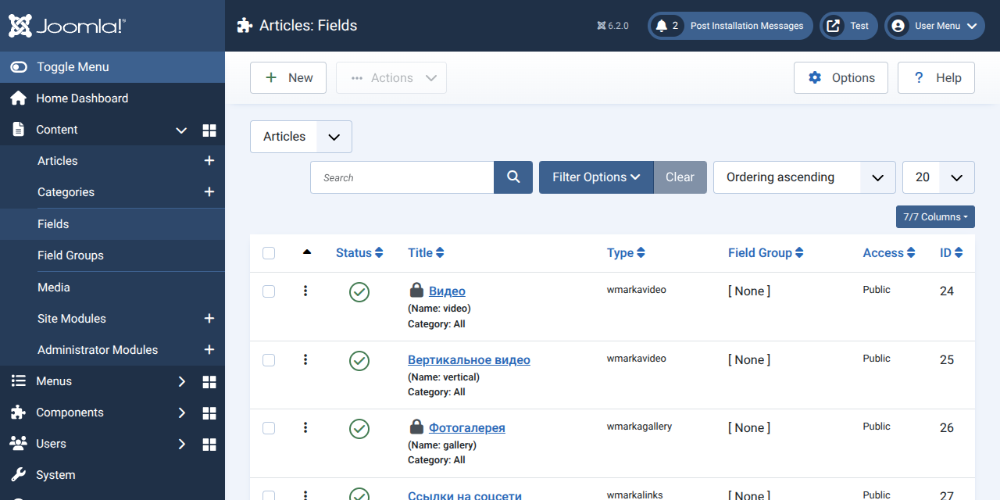
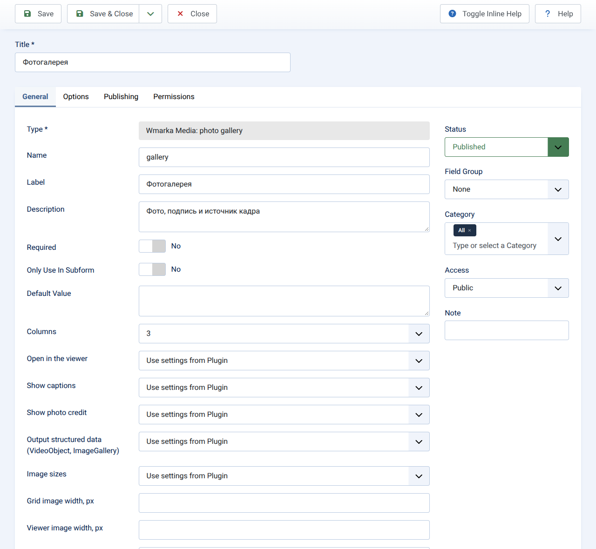
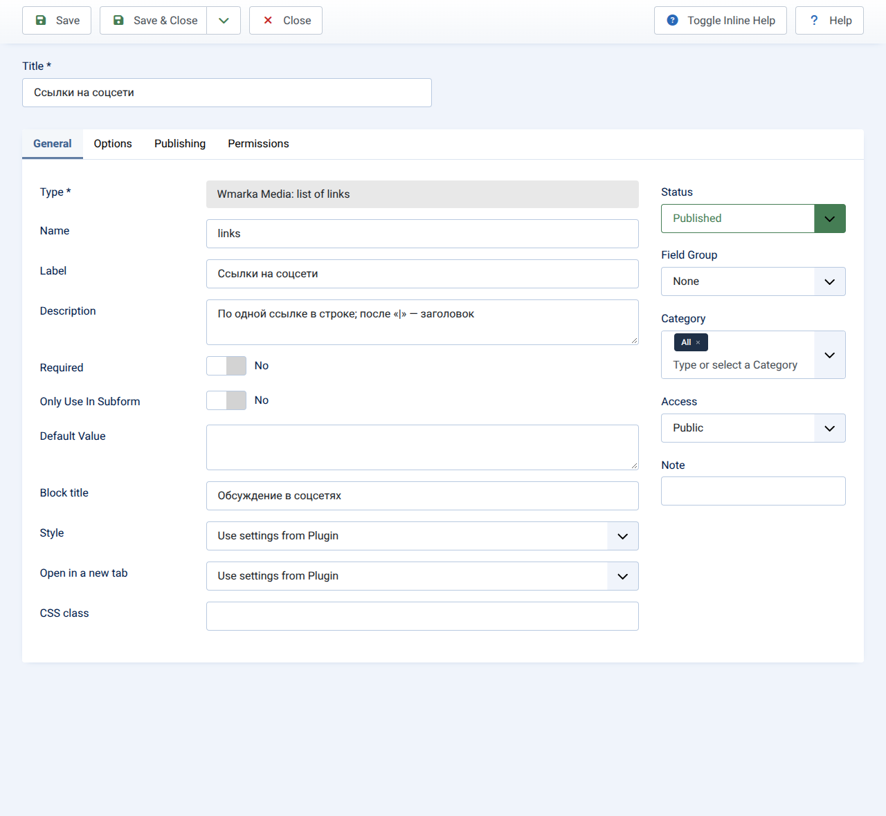
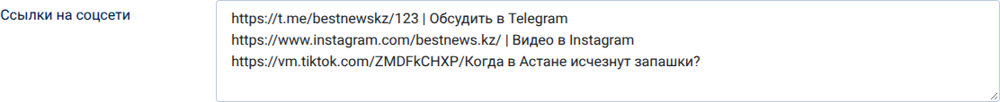
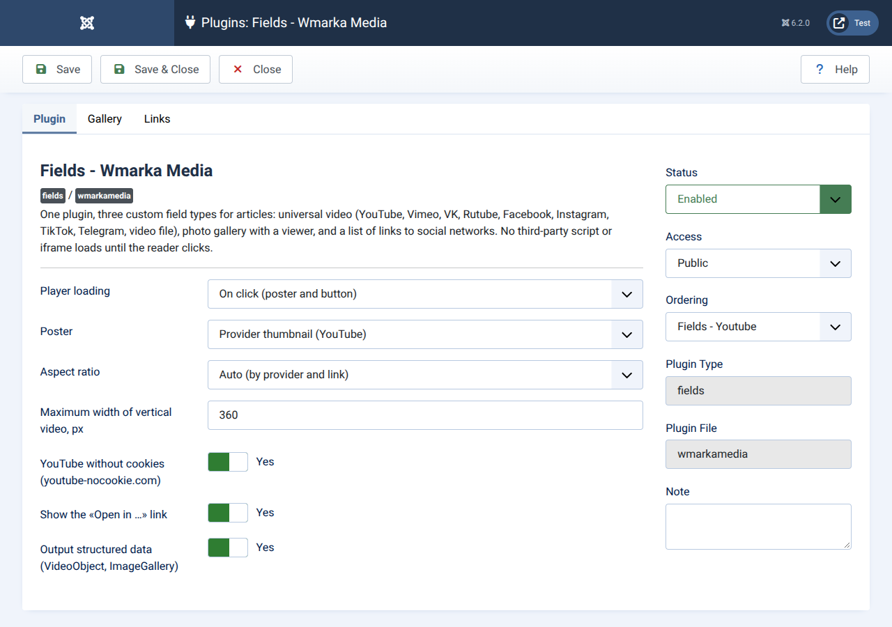
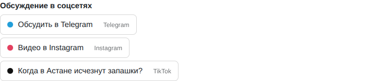
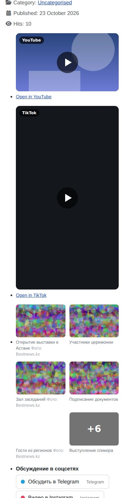

# Wmarka Media — поля «Видео», «Фотогалерея» и «Список ссылок» для материалов Joomla

**Русский** · [English](README.en.md) · [Қазақша](README.kk.md)

Плагин `plg_fields_wmarkamedia` 1.1.2 · Joomla 5.2 и новее, включая 6.x · лицензия GNU GPL версии 2 или новее

## 1. Что это и зачем

Один плагин даёт три типа пользовательского поля для материалов:

| Тип поля | Что вводит редактор | Что видит читатель |
|---|---|---|
| **Wmarka Media: видео** | ссылку на ролик (или код встраивания, или «голый» идентификатор YouTube) | постер с кнопкой; плеер создаётся только по нажатию. Понимает YouTube, Vimeo, VK, Rutube, Facebook, Instagram, TikTok, Telegram и файлы .mp4/.webm |
| **Wmarka Media: фотогалерея** | строки «фото, подпись, источник кадра» | сетка с подписями и окном просмотра (стрелки, Esc, счётчик «Фото 2 из 8») |
| **Wmarka Media: список ссылок** | по одной ссылке в строке, после «\|» можно дать заголовок | список или кнопки со значком сервиса |

Плагин заменяет плагины YouTube и «вертикального видео», список ссылок на соцсети, галереи на штатной подформе и сопутствующие макеты шаблона: данные, ввод, вывод, настройки и перенос старых значений — в одном месте.

**Зачем.** Прежние решения для видео и галерей обычно собираются из нескольких плагинов и макетов шаблона: ролик запускается при открытии страницы, скрипты и стили лежат внутри макетов, значения читаются отдельным запросом на каждый материал, а плагины, написанные для Joomla 3, на Joomla 6 могут не работать (плагин YouTube версии 4.0.0, проверенный на 6.2.0, завершался ошибкой `Class "FieldsPlugin" not found`).

**Почему один плагин, а не одно поле.** В Joomla каждый файл в папке `tmpl/` плагина полей — отдельный тип поля; так устроен и штатный плагин «Медиа» (он даёт четыре типа: изображение, звук, видео, документ). Один плагин поэтому честно даёт несколько типов. Слить видео и фотографии в один тип нельзя: у видео значение — одна строка, у галереи — список строк.

## 2. Требования и что проверено

- Joomla 5.2 и новее; PHP 8.1 и новее (Joomla 6.2 сама требует PHP 8.3).
- Проверено на чистых установках **Joomla 6.2.0** и **Joomla 5.4.9**, PHP 8.3.6, MariaDB 10.11.14, встроенный сервер PHP, Chromium без окна. Подробный протокол — в `docs/TESTS.md`.
- Не проверялось: Joomla 5.2–5.3 и 6.0–6.1, PHP 8.1/8.2/8.4, PostgreSQL, Apache и Nginx, настоящие встраивания чужих сервисов (TikTok, Instagram, Telegram, Facebook, VK, Rutube, Vimeo).

## 3. Установка, обновление, удаление

- **Установка.** «Расширения → Менеджер → Установка», загрузить `plg_fields_wmarkamedia-1.0.0.zip`. Либо из командной строки: `php cli/joomla.php extension:install --path=plg_fields_wmarkamedia-1.0.0.zip`. Плагин включается сам.
- **Обновление.** Joomla сама сообщает о новых версиях («Система → Обновление → Расширения»): плагин регистрирует сервер обновлений (раздел 17). Можно и вручную — установкой новой версии поверх старой; настройки и включённость сохраняются (проверено).
- **Удаление.** «Расширения → Менеджер → Управление» или `php cli/joomla.php extension:remove <номер>`. Файлы, ресурсы в `media/` и языковые файлы убираются (проверено). До удаления смените тип у полей этого плагина или удалите их: иначе в базе останутся поля неизвестного типа.
- Языки интерфейса: английский, русский, казахский (`en-GB`, `ru-RU`, `kk-KZ`). Файлы устанавливаются для тех языков, которые есть на сайте.

## 4. Как создать поле

«Содержимое → Поля → Создать». В списке «Тип» выберите нужный тип «Wmarka Media: …».

- **Видео.** Название — любое (например, «Видео»). Ничего больше обязательно не задавать. Рекомендуем «Автоматический вывод» — «После заголовка» или «Перед содержимым»; подпись поля лучше скрыть.
- **Фотогалерея.** В редакторе материала появится таблица со столбцами «Фото», «Подпись», «Источник кадра» и кнопками добавления, удаления и перемещения строк. Поле «Фото» — штатный выбор из «Медиа» (с текстом `alt`).
- **Список ссылок.** Текстовая область. Допустимы строки: `https://t.me/example_channel`, `https://t.me/example_channel | Обсудить в Telegram`, а также ссылка с заголовком, вклеенным прямо за ней: `https://example.org/page Заголовок`.

Поле можно ограничить рубриками, как любое другое. На вкладке «Параметры» самого поля (внизу) — настройки типа (раздел 6).

### Как это выглядит в админке

Скриншоты сняты на тестовой Joomla 6.2.0 с английским интерфейсом: русский языковой пакет на тестовой установке не ставился. Подписи самих полей («Видео», «Фотогалерея») набраны по-русски.

**Список полей.** В колонке «Type» — типы плагина.



**Настройки типа «Видео».** Верхняя часть формы стандартна для полей Joomla, ниже — параметры плагина; «Use settings from Plugin» значит «как в настройках плагина».


**Настройки типа «Фотогалерея».**



**Настройки типа «Список ссылок».**



**Форма статьи, вкладка «Fields».** Видео — строка со ссылкой; галерея — таблица «Photo, Caption, Credit» со штатным выбором файла из «Медиа» и текстом `alt`; строки добавляются, удаляются и переставляются кнопками.


**Список ссылок в форме статьи** — обычная текстовая область, по ссылке в строке; после «\|» можно дать заголовок.



**Общие настройки плагина** («Расширения → Плагины»): три вкладки, Plugin (видео), Gallery, Links.



## 5. Какие ссылки понимает «Видео»

| Сервис | Принимаются | Вертикальное | Постер | Заметки |
|---|---|---|---|---|
| YouTube | `watch?v=…`, `youtu.be/…`, `/shorts/…`, `/live/…`, `/embed/…`, «голый» идентификатор (в том числе с хвостом `?si=…`), время старта `t=1m30s` или `start=90` | `/shorts/` | да (`i.ytimg.com`) | по умолчанию `youtube-nocookie.com` |
| Vimeo | `vimeo.com/123456789`, `/video/…`, ссылки на каналы и группы, закрытые ролики с `?h=…` | нет | нет | параметр `dnt=1` |
| Rutube | `rutube.ru/video/…`, `/play/embed/…`, `/shorts/…` | `/shorts/` | нет | идентификатор из 32 знаков |
| VK | `vk.com/video-123_456`, `vkvideo.ru/…`, `/clip-…`, `video_ext.php` | `/clip` | нет | `hash` для закрытых |
| Facebook | `/videos/…`, `/reel/…`, `/watch`, `fb.watch/…`, `/share/v/…`, `/share/r/…` | `/reel/`, `/share/r/` | нет | встраивание зависит от настроек приватности ролика |
| Instagram | `/reel/…`, `/reels/…`, `/p/…`, `/tv/…` | `/reel/`, `/tv/` | нет | |
| TikTok | `tiktok.com/@имя/video/123…`, `embed/v2/…` | да | нет | **короткие ссылки** (`vm.tiktok.com/…`, `vt.tiktok.com/…`, `tiktok.com/t/…`) в номер ролика без запроса к сервису не превратить: показывается ссылка «Смотреть на TikTok» |
| Telegram | `t.me/канал/123` (открытые каналы) | нет (соотношение 4:5) | нет | высота встраивания у Telegram своя |
| Файл | `.mp4`, `.webm`, `.ogv`, `.mov`, `.m4v` по абсолютному или относительному адресу | нет | нет | обычный тег `video` |
| Код встраивания | `<iframe …>` и `<blockquote class="tiktok-embed" …>`: берётся адрес, остальное отбрасывается | по адресу | по адресу | чужой код на страницу не попадает |
| Другое | любая ссылка `http(s)://…` | нет | нет | показывается ссылка «Смотреть на example.org» |

Все адреса встраивания собираются из проверенных частей (идентификаторов), а не из текста редактора, поэтому вставить в атрибут `src` произвольную строку нельзя.

## 6. Настройки

Задаются в двух местах: общие значения — в настройках плагина («Расширения → Плагины → Fields - Wmarka Media»), собственные — на вкладке «Параметры» конкретного поля. Пустое значение в поле означает «как в плагине».

**Видео**

| Настройка | Значения | По умолчанию |
|---|---|---|
| Загрузка плеера | по нажатию (постер и кнопка) · сразу (отложенный iframe) | по нажатию |
| Постер | миниатюра сервиса (YouTube) · без картинки | миниатюра |
| Соотношение сторон | авто · 16:9 · 9:16 · 4:5 · 1:1 · 4:3 | авто |
| Наибольшая ширина вертикального видео, px | 200–720 | 360 |
| YouTube без куки | да · нет | да |
| Показывать ссылку «Открыть в …» | да · нет | да |
| Микроразметка | да · нет | да |
| CSS-класс | текст | пусто |

**Фотогалерея**

| Настройка | Значения | По умолчанию |
|---|---|---|
| Столбцы | 1–6 (на телефоне не больше двух) | 3 |
| Окно просмотра | да · нет | да |
| Подписи, источник кадра | да · нет | да |
| Размер картинок | уменьшенные копии (создаются сами) · оригиналы | копии |
| Ширина снимка в сетке, px | 200–2000 | 640 |
| Ширина снимка в окне просмотра, px | 800–4000 | 1920 |
| Показывать первые N снимков | 0 — все; остальные открываются в окне просмотра, на последней плитке стоит «+K» | 0 |
| Наибольшее число фото | 0 — без ограничения | 0 |
| Микроразметка, CSS-класс | да · нет, текст | да, пусто |

**Копии фотографий.** Копии делает сама Joomla (библиотека GD, класс `Image`), в формате WebP, а если GD его не умеет — JPEG. Лежат они в `media/plg_fields_wmarkamedia/cache`; в имени — ширина и отпечаток файла, так что подмена снимка даёт новую копию, а папку можно очистить в любой момент. За один запрос создаётся до 8 миниатюр и до 2 крупных кадров, остальные появляются при следующих показах страницы; пока крупной копии нет, окно просмотра берёт оригинал, а в саму страницу тяжёлые оригиналы не попадают. Оригиналы легче 150 КБ или не шире нужного больше чем на 15 % не пережимаются. Снимки вне папки `images/`, внешние адреса и файлы крупнее 36 млн пикселей остаются как есть.

**Список ссылок**: заголовок блока, вид (список · кнопки), открывать в новой вкладке (да), CSS-класс.

## 7. Что выводится на странице

```html
<div class="wm-video wm-video--youtube" style="--wm-ratio:16/9;" data-wm-video
     data-embed="https://www.youtube-nocookie.com/embed/ID?rel=0&playsinline=1&autoplay=1" data-title="Заголовок материала">
  <button type="button" class="wm-video__btn" aria-label="Смотреть видео: Заголовок материала">
    
    <span class="wm-video__badge">YouTube</span><span class="wm-video__play" aria-hidden="true"></span>
  </button>
  <noscript>…ссылка на ролик…</noscript>
  <a class="wm-video__link" href="https://www.youtube.com/watch?v=ID" target="_blank" rel="noopener noreferrer">Открыть в YouTube</a>
</div>
```

По нажатию скрипт заменяет кнопку на `iframe` с адресом из `data-embed`, ставит на него фокус и добавляет контейнеру класс `is-playing`. Галерея: сетка `wm-gallery` с рисунками и подписями; нажатие открывает окно просмотра на встроенном элементе `<dialog>` (Esc закрывает, ←/→ листают по кругу, фокус возвращается на снимок). Ссылки: `wm-links`.

**Оформление.** Классы с префиксом `wm-`, цвета и размеры — переменные: `--wm-accent`, `--wm-radius`, `--wm-ratio`, `--wm-max` (видео), `--wm-cols` (галерея). Пример подгонки под сайт — `examples/theme.css`.

### Как это выглядит на странице

Тема — стандартная Cassiopeia, картинки галереи синтетические, а постер YouTube на тестовой установке недоступен (внешние сервисы закрыты), поэтому подставлена тестовая картинка.

**Видео.** До нажатия — постер с кнопкой и названием сервиса; вертикальное видео (TikTok, Shorts, Reels) занимает узкую колонку.


**Фотогалерея** в режиме «первые 6 снимков»: на последней плитке — «+6», остальные снимки открываются в окне просмотра.


**Окно просмотра**: счётчик «Photo 7 of 12», подпись и источник кадра, стрелки по краям, Esc закрывает.


**Список ссылок** с заголовками и названием сервиса.



**Телефон** (ширина 375 px): боковой прокрутки нет.



## 8. Приватность и скорость

- **До нажатия** страница обращается к чужому серверу только за постером YouTube (`i.ytimg.com`, одна картинка). Чтобы не обращаться вовсе, выберите «Постер: без картинки»: тогда до нажатия нет ни одного запроса к чужим сайтам.
- **После нажатия** загружается плеер сервиса и работают его куки (для YouTube по умолчанию — `youtube-nocookie.com`).
- Ресурсы плагина: скрипт 4,4 КБ (1,7 КБ по сжатию gzip), стили 4,9 КБ (1,8 КБ). Библиотек нет. Встроенных скриптов нет, кроме блока микроразметки.
- У галереи первый кадр грузится сразу и с высоким приоритетом (`loading="eager"`, `fetchpriority="high"`): он чаще всего и есть самый крупный элемент страницы; остальные кадры — отложенно. Число проверок и замеры — в разделе 9.
- Постер, который не загрузился (блокировщик, сбой сети), скрипт убирает, чтобы не торчал значок битой картинки.

## 9. Производительность

Плагин не тянет библиотек: скрипт 4,4 КБ и стили 4,9 КБ (1,7 и 1,8 КБ в сжатом виде). Копии фотографий создаются автоматически (раздел 6); первый кадр галереи грузится сразу и с высоким приоритетом, остальные — отложенно; в режиме «первые N снимков» тяжёлые картинки в страницу не попадают.

Пример замера: Joomla 5.4.9, стандартная тема Cassiopeia, одни и те же снимки 2400×1600 (по 790 КБ), Chromium без окна, сеть ограничена до «медленного 4G» (1,6 Мбит/с, задержка 150 мс), кэш браузера выключен, три прогона, берётся средний.

| | галерея из 8 снимков | галерея из 38 снимков, показаны первые 6 |
|---|---|---|
| запросов к серверу | 24 | 22 |
| вес страницы, КБ | 834 | 774 |
| из них фотографии, КБ | 278 | 210 |
| из них код плагина, КБ | 9 | 9 |
| из них тема и ядро Joomla, КБ | 530 | 530 |
| HTML страницы, КБ | 16 | 24 |
| узлов DOM | 161 | 180 |
| LCP, с | 2,2 | 3,2 |

Что замер не доказывает: это одна машина, имитация сети и синтетические снимки с шумом (для кодирования они тяжелее обычных), а не данные с живых сайтов. Видео до нажатия не создаёт ни одного `iframe` (проверено в браузере); до чужого сервера доходит только картинка-постер YouTube, а при настройке «Постер: без картинки» — ничего.

## 10. Микроразметка

Для видео выводится `VideoObject` (название, описание, дата, адрес встраивания, миниатюра) **только когда известна картинка**: постер YouTube или обложка материала. Без картинки такую разметку поисковики отвергают, поэтому плагин её не выводит. Для галереи — `ImageGallery` со списком `ImageObject` (адрес, подпись, источник). Отключается настройкой «Микроразметка».

## 11. Переопределение макетов и использование в модулях

- **Переопределение.** Файл `templates/<шаблон>/html/plg_fields_wmarkamedia/wmarkavideo.php` (или `wmarkagallery.php`, `wmarkalinks.php`) заменяет макет плагина (проверено). Пример — `examples/override-wmarkavideo.php`. В макете доступны `$field`, `$fieldParams`, `$item`.
- **В макетах модулей.** Разбор ссылок доступен как класс:
  ```php
  use Wmarka\Plugin\Fields\WmarkaMedia\Helper\VideoHelper;
  $ref = VideoHelper::parse($значение);   // VideoRef или null
  // $ref->provider, ->label, ->id, ->page, ->embed, ->embedPlay, ->vertical, ->ratio, ->poster, ->kind
  ```
  Значения поля для всех материалов списка берутся одним запросом, а не вызовом `FieldsHelper::getFields()` на каждый материал: пример — `examples/module-layout-one-query.php` (проверен).

## 12. Перенос со старых полей

Соответствие:

| Было | Стало | Что происходит со значениями |
|---|---|---|
| тип `youtube` (Joomill) | `wmarkavideo` | не меняются: читаются «голые» идентификаторы, идентификаторы с `?si=…`, ссылки, одна ссылка TikTok из поля YouTube |
| тип `verticalvideo` | `wmarkavideo` | не меняются |
| текстовая область со ссылками на соцсети (например, `social`) | `wmarkalinks` | не меняются, читаются форматы «ссылка», «ссылка \| заголовок», «ссылка заголовок» |
| подформа «Фотогалерея», «Фотогалерея 2025» | `wmarkagallery` | строки переписываются из `{"row0":{"field15":{…},"field14":"…"}}` в `{"row0":{"image":{…},"caption":"…","credit":""}}`; пустые значения (`[]`) можно удалить |

Скрипт `tools/migrate-fields.php` делает это одной командой. **По умолчанию он только показывает, что сделает**; запись — с ключом `--apply`, перед записью создаётся файл копии строк, откат — `--rollback`:

```
php migrate-fields.php --video --links=social --galleries=13,19 --trash-subfields --purge-empty            # пробный прогон
php migrate-fields.php --video --links=social --galleries=13,19 --trash-subfields --purge-empty --apply    # запись
php migrate-fields.php --rollback=migrate-fields-backup-ГГГГММДД-ЧЧММСС.json                               # откат
```

Скрипт кладут в корень сайта (рядом с `configuration.php`) или указывают `--base=/путь/к/сайту`. Номера полей — со страницы «Содержимое → Поля». **Перед записью — резервная копия базы.** Скрипт проверен на тестовой Joomla 6.2.0 с воспроизведённой структурой полей: пробный прогон, запись, страница, форма в админке, откат (выборки из таблиц полей и значений совпали с исходными).

После переноса вручную:
1. Удалить плагины `youtube`, `verticalvideo`, `sociallist`.
2. Убрать из шаблона переопределения этих полей и блок вертикального видео в `html/com_content/article/default.php` (он перебирает все поля по подстроке `tiktok.com` и `shorts/`): плагин делает это сам.
3. Проверить «Автоматический вывод» у перенесённых полей.
4. Если у старой галереи было отдельное устаревшее поле (скрытое в админке или не используемое), решите, нужно ли оно.

Без скрипта то же для видео делается запросом (параметры поля с ключом `layout` лучше очистить скриптом):
```sql
UPDATE `#__fields` SET `type` = 'wmarkavideo', `fieldparams` = '{}' WHERE `type` IN ('youtube', 'verticalvideo');
```

## 13. Ограничения

- Короткие ссылки TikTok остаются ссылками (раздел 5).
- Встраивания Facebook, Instagram, TikTok, Telegram, VK, Rutube зависят от сервисов и от настроек приватности роликов; в тестах их адреса проверялись, сами ролики — нет.
- Постер берётся без запроса к интерфейсам сервисов, поэтому он есть только у YouTube.
- Копии фотографий требуют библиотеку GD и обрабатывают только файлы внутри `images/` (JPEG, PNG, WebP). Первые показы создают копии порциями (раздел 6): откройте страницу после публикации, чтобы «прогреть» кэш. Старые копии при замене снимка сами не удаляются.
- Режима «слайдер с лентой миниатюр» (как на нынешнем сайте) в плагине нет: это другая вёрстка, её делают переопределением макета.
- Автозапуск ролика после нажатия зависит от правил браузера; звук включается как у обычного плеера.

## 14. Слова, которые стоит объяснить

**Фасад.** Слово пришло из французского *façade* и итальянского *facciata*, от латинского *facies* — «лицо, вид». В архитектуре это лицевая сторона здания. В программировании «фасад» — приём из книги «банды четырёх» (1994): простой «лицевой» объект скрывает сложное устройство за ним. В вебе «плеер-фасад» — картинка с кнопкой на месте настоящего плеера: тяжёлый чужой плеер создаётся только после нажатия.

**Плагин.** От английского *plug-in*: *plug* — «пробка, вилка», *in* — «внутрь»; то, что вставляют в готовую программу, как вилку в розетку. В Joomla плагин подписывается на события системы и вмешивается в её работу, не меняя ядро.

**iframe.** Сокращение от *inline frame* — «встроенный кадр»: окно внутри страницы, в котором показывается другая страница. Тег появился в Internet Explorer 3 (1996) и вошёл в HTML 4.0 (1997). Именно в таком окне работают плееры YouTube и других сервисов.

**Микроразметка (JSON-LD).** Сведения о странице в виде, понятном поисковой машине, а не читателю. *LD* — *Linked Data*, «связанные данные»; словарь `schema.org` создали в 2011 году Google, Bing и Yahoo, вскоре к ним присоединился Яндекс, а формат JSON-LD стал рекомендацией W3C в 2014 году.

## 15. Лицензия и авторство

Код написан заново; код сторонних плагинов полей видео не использовался: взято только наблюдаемое поведение (какие ссылки понимать). Лицензия — GNU GPL версии 2 или новее (файлы `LICENSE` в репозитории и `src/LICENSE.txt` в плагине). В манифесте указан автор Beibit Sakhanov и адрес https://webmarka.kz: при публикации под другим именем измените строки `author`, `authorUrl`, `copyright` в `src/wmarkamedia.xml` и в заголовках файлов.

## 16. История версий

- **1.1.2** — исправлено: постер YouTube не обрезается снизу в шаблонах, где у `img` задано `height:auto`.
- **1.1.1** — сервер обновлений, сборочный скрипт, проверки, CI, репозиторий.
- **1.1.0** — уменьшенные копии фотографий (GD, кэш в `media`), режим «первые N снимков и +K», первый кадр галереи грузится сразу и с высоким приоритетом, ширина миниатюры по умолчанию 640 px.
- **1.0.0** — первая сборка: три типа поля, разбор ссылок на видео, окно просмотра, список ссылок с заголовками, скрипт переноса старых полей.

## 17. Установка из репозитория и сервер обновлений

Готовый архив — в разделе Releases (файл `plg_fields_wmarkamedia-<версия>.zip`). Плагин сам регистрирует сервер обновлений `https://raw.githubusercontent.com/bsakhanov/plg_fields_wmarkamedia/main/updates.xml`: о новых версиях Joomla сообщает в админке.

Проверено на тестовой Joomla 6.2.0: запись в таблице серверов обновлений создаётся при установке; локальный сервер с версией 1.1.2 был обнаружен проверкой обновлений, а после установки 1.1.2 предложение исчезло. Не проверялось: обновление кнопкой в админке, сверка контрольной суммы, загрузка с GitHub.

## 18. Разработка и сборка

| Что | Где |
|---|---|
| содержимое плагина (попадает в архив) | `src/` |
| сборка `dist/plg_fields_wmarkamedia-<версия>.zip` и запись в `updates.xml` | `php build.php`; `--check` — только проверить; `--checksum` — записать sha256 (см. `docs/PUBLISHING.md`) |
| проверки без Joomla (67 штук: разбор ссылок, галерея, пути картинок, языки, манифест) | `php tests/run.php` |
| перенос старых полей | `tools/migrate-fields.php` |
| примеры переопределения макета, выборки значений, стилей | `examples/` |
| проверка синтаксиса, тесты на PHP 8.1–8.4, сборка, релиз по тегу `v*` | `.github/workflows/ci.yml` |
| выпуск новой версии, создание репозитория | `docs/PUBLISHING.md` |
| протокол проверок | `docs/TESTS.md` |

Файл CI настроен, но при подготовке не запускался: проверьте первый запуск в GitHub Actions. Сборка воспроизводима на одной машине (две сборки подряд дали один и тот же архив).

## 19. Вклад и обратная связь

Ошибки и пожелания — в Issues (есть шаблоны), правки — через Pull Request: перед отправкой запустите `php tests/run.php` и `php build.php --check`. Строки интерфейса лежат в `src/language/<язык>/`; для нового языка достаточно двух `.ini`-файлов и двух строк в манифесте.

## Список использованных источников

1. Joomla 6.2.0: `administrator/components/com_fields/src/Plugin/FieldsPlugin.php`, `administrator/components/com_fields/src/Helper/FieldsHelper.php`, `plugins/fields/text`, `plugins/fields/media`, `plugins/fields/subform`, `cli/joomla.php`.
2. Joomla 5.4.9: те же расширения (для проверки совместимости).
3. Штатные макеты полей Joomla и документация формата обновлений (`updates.xml`) — для проверки совместимости.
